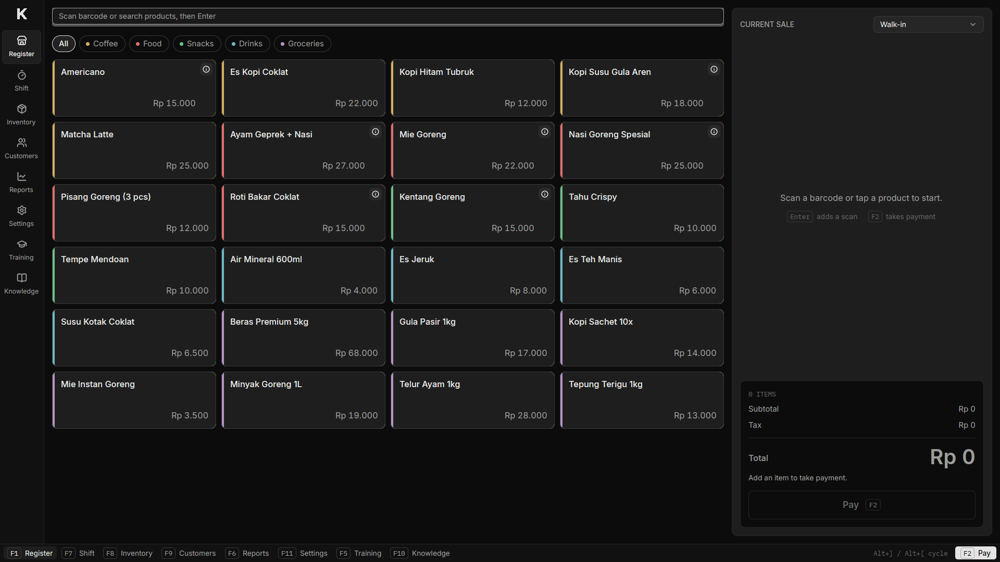

# Kaseer

Kaseer is an offline-first point-of-sale terminal for small shops, cafés and warungs. It is a
native desktop app written in Rust on [GPUI Kit](https://crates.io/crates/gpui-kit): one binary,
a local SQLite ledger, and a keyboard-first register that keeps selling when the internet is down.



## What it does

- **Register**: barcode scan or tap, categories, cart discounts, customers and loyalty points,
  cash/card/QRIS/transfer tenders with change, receipts (ESC/POS).
- **Shift**: open and close the till, cash counts, the shift's sales.
- **Inventory, Customers, Reports**: stock levels, the customer list, daily sales.
- **Training mode**: a sandbox ledger for new cashiers; real sales are never touched.
- **Knowledge**: product notes the cashier can look up at the counter.
- **Cloud sync (optional)**: sales queue in a local outbox and drain to
  [Kaseer Cloud](https://kaseer.site) when online; the menu, photos and app updates come back
  the same way. Without a cloud, Kaseer works fully on its own.

Keyboard: F1 Register, F7 Shift, F8 Inventory, F9 Customers, F6 Reports, F11 Settings,
F5 Training, F10 Knowledge, Alt+] / Alt+[ to cycle screens, F2 to pay.

## Download

Get the latest build from [Releases](https://github.com/dzulfikar08/kaseer-rs/releases/latest):

| Platform | File |
|---|---|
| Windows 10/11 | `Kaseer-Setup-X.Y.Z-x64.exe` (installer, no admin rights) or `Kaseer-X.Y.Z-x64.zip` (portable) |
| macOS 11+ (Apple Silicon and Intel) | `Kaseer-X.Y.Z.dmg` |
| Linux x86_64 / aarch64 | `Kaseer-X.Y.Z-<arch>.AppImage` or `kaseer-X.Y.Z-<arch>-linux.tar.gz` |

The macOS build is signed with a Developer ID and notarised by Apple. The Windows build is not
code-signed yet: if SmartScreen stops the installer, choose **More info**, then **Run anyway**.
Linux builds need glibc 2.39 or newer (Ubuntu 24.04, Debian 13, Fedora 40 or later).

Verify downloads with `sha256sum -c SHA256SUMS --ignore-missing`.

## Data

The ledger, sync outbox, product photos and training sandbox live in one folder:

| Platform | Folder |
|---|---|
| Linux | `~/.local/share/kaseer` (or `$XDG_DATA_HOME/kaseer`) |
| macOS | `~/Library/Application Support/Kaseer` |
| Windows | `%APPDATA%\Kaseer` |

A `./data/kaseer.db` in the working directory takes precedence (terminals set up before 0.3, and
`cargo run` from a checkout). Environment overrides: `KASEER_DATA_DIR`, `KASEER_DB`,
`KASEER_OUTBOX`, `KASEER_CLOUD_URL` (default `https://cloud.kaseer.site`, also editable in
Settings) and `KASEER_COMPANION_URL`.

## Build from source

Needs stable Rust. On Linux, install GPUI's system libraries first (see `scripts/ci-deps.sh` for
the Ubuntu package list).

```sh
cargo run -p kaseer            # debug build, data in ./data if present
cargo test --workspace         # core and app tests
cargo build --release -p kaseer
```

The workspace has two crates: `core` (ledger, cart, money, tax, sync, reports; no UI) and `app`
(the GPUI Kit desktop app). The UI follows the design spec in [docs/ATUR_STYLE.md](docs/ATUR_STYLE.md).

## Releases

Releases are built by GitHub Actions (`.github/workflows/release.yml`). To cut one, bump
`[workspace.package] version` in `Cargo.toml`, add a `## [X.Y.Z]` section to `CHANGELOG.md`,
then tag:

```sh
git tag -a v0.3.0 -m "Kaseer 0.3.0" && git push origin v0.3.0
```

Each release also carries the raw binaries (`kaseer-X.Y.Z-<arch>-linux`,
`kaseer-X.Y.Z-x86_64-windows.exe`). Kaseer Cloud reads the latest release's `SHA256SUMS` and serves
the matching binary to enrolled terminals as their auto-update, so publishing a release is all it
takes; no upload step and no credentials. (AppImage and macOS installs update by downloading a new
release.)

`gh workflow run release.yml --ref main` does a dry run that builds every package without
publishing.

## License

Kaseer is free software under the [GNU Affero General Public License v3.0 or later](LICENSE).
If you run a modified Kaseer for others, including over a network, you must offer them its source.

Bundled fonts: Inter and IBM Plex Mono, both under the SIL Open Font License 1.1
(`app/assets/fonts/*-LICENSE.txt`). Icons: Lucide (ISC), through GPUI Kit.
